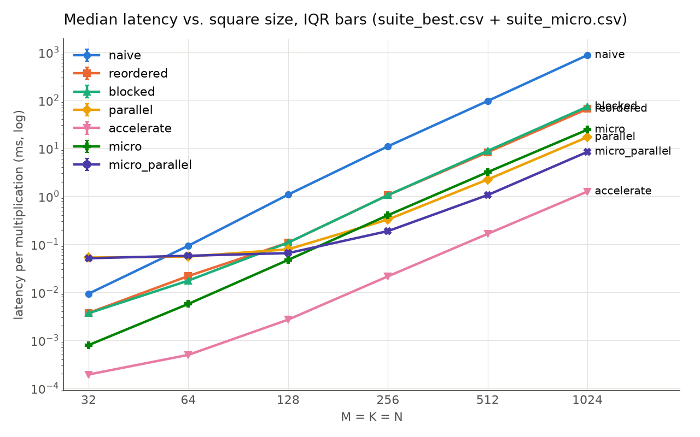
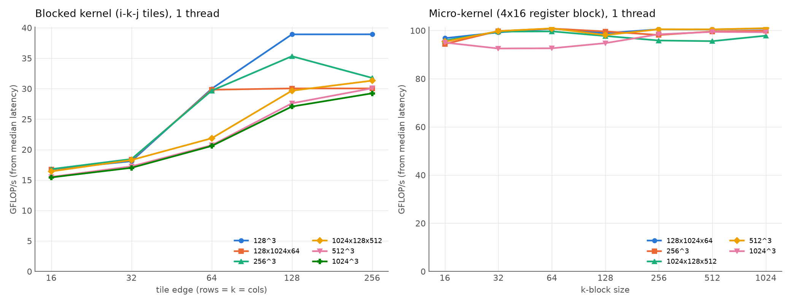
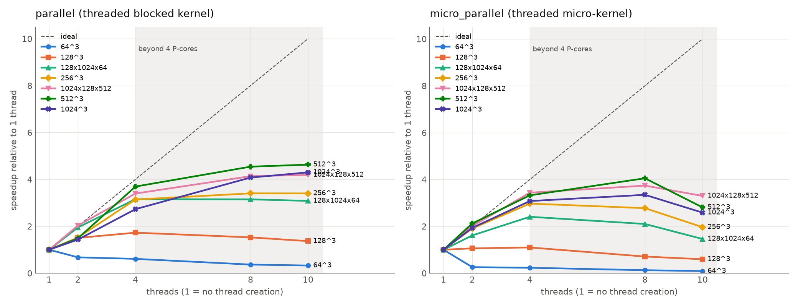

# MacMat performance report

## Environment

| Item | Value |
|---|---|
| Chip | Apple M4, 4 performance + 6 efficiency cores, 10 hardware threads |
| Caches | 128 KB L1d per P-core, 16 MB shared L2 (P-cluster), 4 MB L2 (E-cluster), 128 B lines |
| Memory | 16 GB |
| macOS | 26.6.2 |
| Compiler | Apple clang 21.0.0 (clang-2100.1.1.101), Command Line Tools |
| Flags | `-O3 -DNDEBUG -g` for every implementation (default arm64 target, NEON, no `-ffast-math`) |
| Power | plugged in, low-power mode off ("automatic") |
| Threads | 10 by default for `parallel` / `micro_parallel`; Accelerate's threading not configured unless noted |
| Timing | `std::chrono::steady_clock`, 3 warm-ups, 15 samples, batched to >= 5 ms per sample |

All numbers below are medians; CSVs in `results/` carry Q1/Q3/IQR. Repeats with
rotated implementation order agreed to within a few percent (e.g. `parallel` at
512^3: 89.5 +/- 0.9 GFLOP/s over three repeats; `accelerate` varied most, +/- 2%).

## Headline results (standard suite, `results/suite_best.csv` and `results/suite_micro.csv`)

GFLOP/s from median latency. `blocked` and `parallel` use tile 256 (best in the sweep);
`micro*` use k-block 1024.

| M x K x N | naive | reordered | blocked | parallel (10 thr) | accelerate | micro | micro_parallel (10 thr) |
|---|---|---|---|---|---|---|---|
| 32^3 | 7.0 | 17.7 | 18.0 | 1.2 | 339 | 83 | 1.3 |
| 64^3 | 5.6 | 24.1 | 30.0 | 9.5 | 1060 | 92 | 9.1 |
| 128^3 | 3.9 | 39.0 | 38.9 | 53.6 | 1564 | 89 | 64 |
| 256^3 | 3.1 | 31.9 | 31.9 | 102.8 | 1569 | 84 | 180 |
| 512^3 | 2.8 | 32.6 | 30.5 | 120.6 | 1633 | 85 | 254 |
| 1024^3 | 2.5 | 32.6 | 29.2 | 126.0 | 1714 | 88 | 256 |
| 1024x128x512 | 3.4 | 32.6 | 31.5 | 120.7 | 1542 | 84 | 286 |
| 128x1024x64 | 2.4 | 27.6 | 30.0 | 79.8 | 877 | 87 | 136 |
| 127x255x63 | 3.4 | 19.9 | 20.2 | 40.1 | 1096 | 24 | 44 |

Latency at 1024^3: naive 870 ms, reordered 65.8 ms, blocked 73.5 ms, parallel 17.0 ms,
micro 21.7 ms, micro_parallel 8.4 ms (6.6 ms with 8 threads), accelerate 1.25 ms.

## Experiment 1: loop ordering

*Prediction:* i-k-j makes the inner loop stride-1 over B and C, so the compiler can
vectorize it and the hardware prefetcher can keep up; expect several-x over i-j-k.

*Measured:* 13x at 1024^3 (2.5 -> 32.6 GFLOP/s), 2.5x at 32^3 where everything is in L1.

*Why (from `results/vectorization_report.txt` and the disassembly):* Clang reports
that it vectorized **both** inner loops. For `naive` it keeps the in-order FP
reduction (no `-ffast-math`): the code multiplies four products with `fmul.4s` and
then adds them with four dependent scalar `fadd`s, and the four B values are gathered
from four different rows (`B[k*N+j]`, stride N). That is a serial dependency chain plus
a strided gather, so "vectorized" buys nothing. For `reordered` the j loop is a
unit-stride `c[j] += a*b[j]` with width 4, interleave 4: sixteen independent lanes
per iteration. The 2.5x at 32^3 is the vectorization effect alone; the extra 5x at
large sizes is the memory-access pattern.

## Experiment 2: tile sizes 16, 32, 64, 128 (and 256) - the unsuccessful optimization

*Prediction:* blocking the i-k-j loop so an A tile and a B strip stay in L1 should beat
`reordered` at 512^3 and 1024^3, with the best tile around 32 to 64 (a 64x64 float
tile is 16 KB).

*Measured (`results/tile_sweep.csv`, single thread, GFLOP/s):*

| shape | 16 | 32 | 64 | 128 | 256 |
|---|---|---|---|---|---|
| 128^3 | 16.7 | 18.1 | 30.0 | 38.9 | 38.9 |
| 256^3 | 16.8 | 18.4 | 29.7 | 35.3 | 31.8 |
| 512^3 | 15.5 | 17.2 | 20.7 | 27.6 | 30.1 |
| 1024^3 | 15.4 | 17.0 | 20.6 | 27.1 | 29.2 |
| 1024x128x512 | 16.4 | 18.3 | 21.9 | 29.7 | 31.3 |
| 128x1024x64 | 16.7 | 18.4 | 29.8 | 30.0 | 30.0 |

The prediction was wrong. Throughput rises monotonically with tile size and converges
on the un-blocked `reordered` value; no tile beats it at any shape. Two observations
pin down why:

1. **The slowdown is independent of problem size.** Tile 16 gives ~16 GFLOP/s at
   32^3 (16 KB total, entirely L1-resident) and at 1024^3 alike. A cache effect would
   grow with size. The cost is in the inner loop itself: with a 16-wide j range the
   vectorized body (16 floats per iteration) executes once per k and then falls into
   prologue/epilogue code; and `c[j] += aik*b[j]` loads and stores the C tile on every
   k step, so successive k iterations are chained through memory on the same C
   addresses (store-to-load forwarding latency instead of independent FMAs).
2. **At these sizes the working set already fits the M4's 16 MB L2.** Three 1024^2
   float matrices are 12 MB. `reordered` streams full 4 KB rows of B that the hardware
   prefetcher handles, so there are few misses to remove. The best tile does depend on
   shape, but only in the sense that a tile >= the shortest matrix edge wins: 128^3
   saturates at tile 128, 128x1024x64 at 64.

To test the cache hypothesis properly, a 2048^3 run (48 MB working set, beyond L2;
`results/large_2048.csv`): reordered 32.5 GFLOP/s, blocked 19.4 / 22.0 / 27.2 at tile
64 / 128 / 256. Still no win: the inner-loop cost dominates the modest miss savings.
With the register-blocked micro-kernel the picture changes: k-block 256 (93.6 GFLOP/s)
beats k-block 1024 (89.3) and 64 (87.5), the first measurable benefit of cache
blocking in the whole project, and only once data exceeds L2. Below that, k-block
size changes `micro` by under 5% (right panel above).

## Experiment 3: thread counts 1, 2, 4, 8, 10

*Prediction:* near-linear to 4 threads (four P-cores), sub-linear beyond because the
six E-cores are slower and the row split is static; thread creation (~tens of us)
should dominate below ~128^3.

*Measured (`results/thread_scaling.csv`, `parallel`, tile 256, median ms):*

| shape | 1 | 2 | 4 | 8 | 10 |
|---|---|---|---|---|---|
| 64^3 | 0.018 | 0.027 | 0.029 | 0.049 | 0.055 |
| 128^3 | 0.108 | 0.072 | 0.063 | 0.071 | 0.079 |
| 256^3 | 1.131 | 0.744 | 0.360 | 0.332 | 0.333 |
| 512^3 | 9.991 | 6.723 | 2.705 | 2.200 | 2.159 |
| 1024^3 | 73.5 | 51.3 | 26.9 | 18.0 | 17.1 |

- Speedup at 4 threads is 2.7x (1024^3) to 3.7x (512^3); at 10 threads 4.3x to 4.6x.
  Beyond four threads the extra work lands on E-cores and, because rows are split
  statically, the slowest thread sets the finish time.
- `parallel` is slower than single-threaded at 64^3 and barely helps at 128^3: creating
  and joining nine threads costs about 40 to 50 us per call (`parallel` at 32^3 takes
  53 us versus 4 us for `blocked`), which is the whole runtime of a 64^3 product.
- `micro_parallel` peaks at **8 threads** (1024^3: 6.6 ms, 327 GFLOP/s, 3.3x) and gets
  *slower* at 10 (8.5 ms). With a 3x faster per-thread kernel the fixed costs and the
  P/E imbalance are proportionally larger; 2 threads at 1024^3 gives only 1.9x.
- Profiles agree (`results/profiles/summary.txt`): at 1024^3 the `parallel` process
  spends 94% of samples in the kernel, 5% with the main thread blocked in `join`, and
  under 1% in thread start-up; `micro_parallel` spends 88% / 6.5% / 5%.

A persistent worker pool and a dynamic (work-stealing) row split are the obvious next
experiments; neither is implemented here, and per-call creation is kept so that its
overhead is part of every `parallel` measurement, as the project specified.

## Experiment 4: compiler vectorization

From `results/vectorization_report.txt` (Apple clang 21, `-O3`):

| Loop | Result |
|---|---|
| naive, inner k (`kernels.cpp:18`) | "vectorized, width 4, interleave 4" but as an in-order reduction: `fmul.4s` + 4 serial `fadd`, strided gather of B |
| reordered, inner j (`:36`) | vectorized, width 4, interleave 4 (16 floats per iteration, unit stride) |
| blocked, inner j (`:67`) | vectorized, width 4, interleave 4, plus a scalar epilogue for partial tiles |
| parallel dispatch loops (`:112`, `:123`) | not vectorized (contain `std::thread` calls); irrelevant to throughput |
| micro-kernel | written with NEON intrinsics (`vfmaq_f32`), 16 accumulators in registers; not a candidate for the loop vectorizer |

The vectorizer's remark for `naive` is a good example of why a diagnostic must be
read next to the disassembly: the loop *is* vectorized by the compiler's definition and
*is not* faster.

## Strongest improvement

The register-blocked micro-kernel: 32.6 -> 99 GFLOP/s single-threaded at 1024^3
(3.0x over `reordered`, 40x over `naive`), and 256 to 327 GFLOP/s threaded. It keeps a
4-row x 16-column block of C in sixteen NEON registers across the whole k range, so per
k step it performs 16 FMAs for 4 vector loads of B and 4 scalar broadcasts of A, and C
is touched once per k-block instead of once per k. That changes the inner loop from
load/store-bound (one load of B, one load and one store of C per FMA) to FMA-bound.
Edges (rows not a multiple of 4, columns not a multiple of 16) take a scalar path, which
is why 127x255x63 (N = 63 = 3 full tiles + 15 edge columns) only reaches 24 GFLOP/s;
padding or a narrower edge kernel would fix that.

## The remaining gap to Accelerate

Accelerate's `cblas_sgemm` reaches 1.5 to 1.8 TFLOP/s on this machine, 6x to 7x faster
than the best threaded kernel here and 17x faster than the best single-threaded one.
Most of that gap is not about loops at all: on Apple silicon Accelerate dispatches
sgemm to the AMX matrix coprocessor, whose throughput is far beyond what the NEON
units on the cores can deliver (NEON peak for one P-core is roughly 4 pipes x 4 lanes
x 2 flop x ~4.4 GHz = ~140 GFLOP/s; `micro` reaches ~70% of that). So this is a
comparison of hardware units as much as of code. Accelerate's threading was left
unconfigured; setting `VECLIB_MAXIMUM_THREADS=1` changed 1024^3 from 1827 to 1576
GFLOP/s and 512^3 from 1696 to 1579, i.e. it is mostly single-threaded already at
these sizes (`results/accelerate_threads.csv`). Accelerate's per-call overhead is also
tiny: 0.2 us at 32^3, where `parallel` pays 53 us to create threads.

What would close the NEON-side gap: packing A and B panels into contiguous buffers
(outside the kernel, or in a pre-allocated workspace), a larger micro-tile (e.g. 8x12
to use more of the 32 NEON registers), software prefetch, and a worker pool. Beyond
that, matching Accelerate would require using AMX itself, which has no public API.

## Where changes stop helping (summary)

| Change | Helps when | Stops helping because |
|---|---|---|
| Loop reordering | always; 2.5x to 13x | the kernel becomes load/store-bound at ~32 GFLOP/s |
| i-k-j cache blocking | never on this chip at <= 1024^3 | working set fits 16 MB L2; short tiles cost more in loop overhead than they save in misses |
| k-blocking with the micro-kernel | only above L2 (2048^3): +5% | below L2 the prefetcher already hides B's streaming |
| Register blocking | always above ~64^3: 3x | edge tiles (scalar path), remaining load/FMA ratio, no packing |
| Threads | >= 256^3; up to 4.6x on 10 threads | per-call thread creation (~45 us), static split across unequal P/E cores; `micro_parallel` is best at 8 threads |

## Caveats

- Instruments was not available (no Xcode on the machine; the Command Line Tools do
  not ship `xctrace`). The profiles were taken with `/usr/bin/sample`, which is also a
  1 ms call-stack sampler; `scripts/profile.sh` switches to Instruments automatically
  when Xcode is installed. Neither tool measures cache misses: every statement about
  caches above is inferred from timing behaviour across sizes, not observed directly.
- GFLOP/s uses 2MKN for every implementation, including the padded/edge work of the
  micro-kernel and whatever Accelerate does internally.
- Thermal state was not controlled beyond keeping the machine idle and rotating the
  implementation order between repeats; results agreed across repeats to a few percent.
